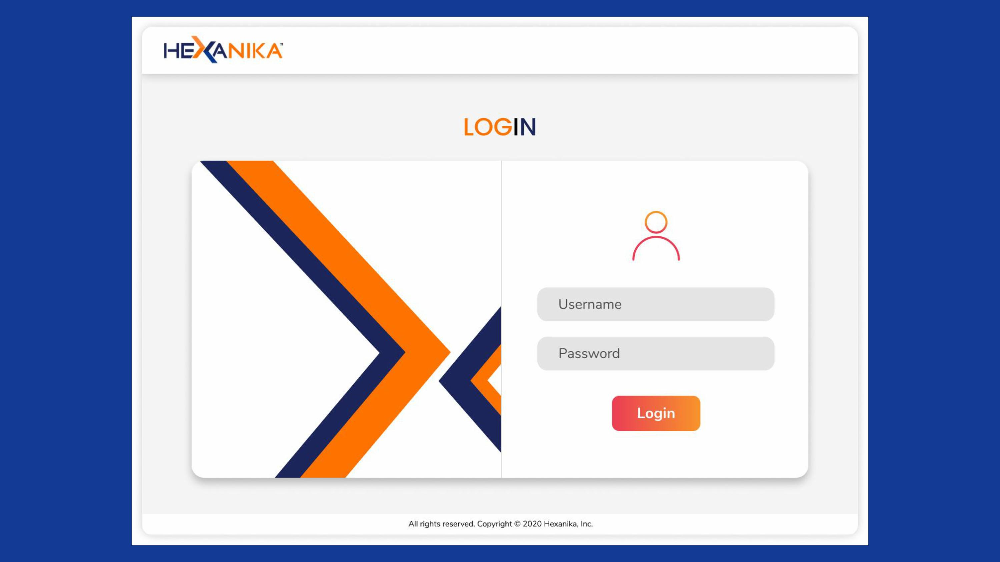
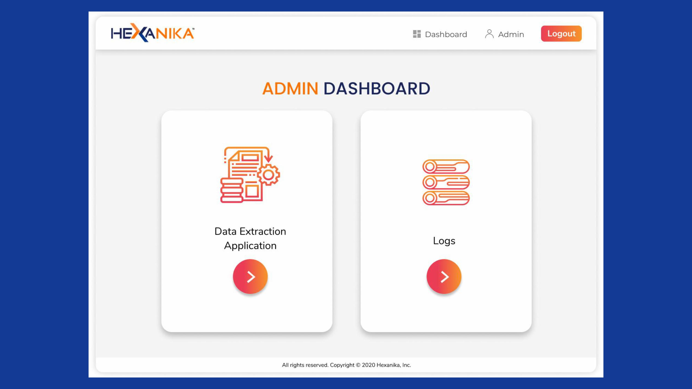
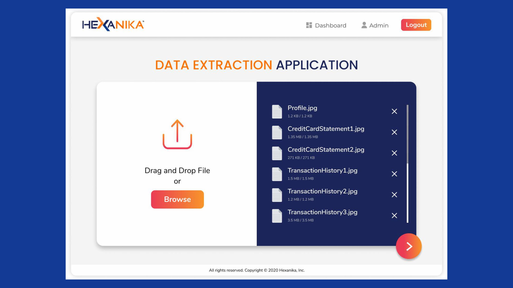
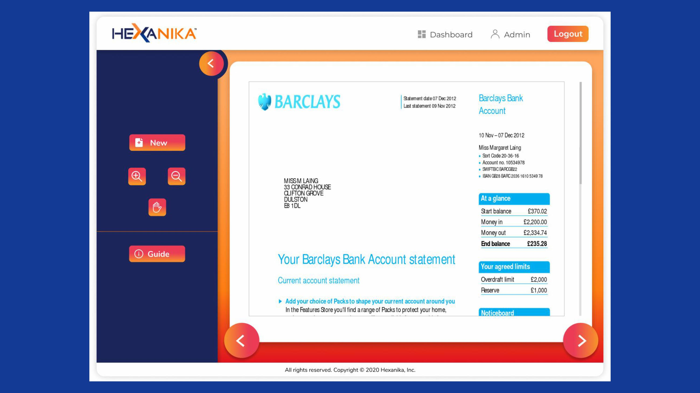
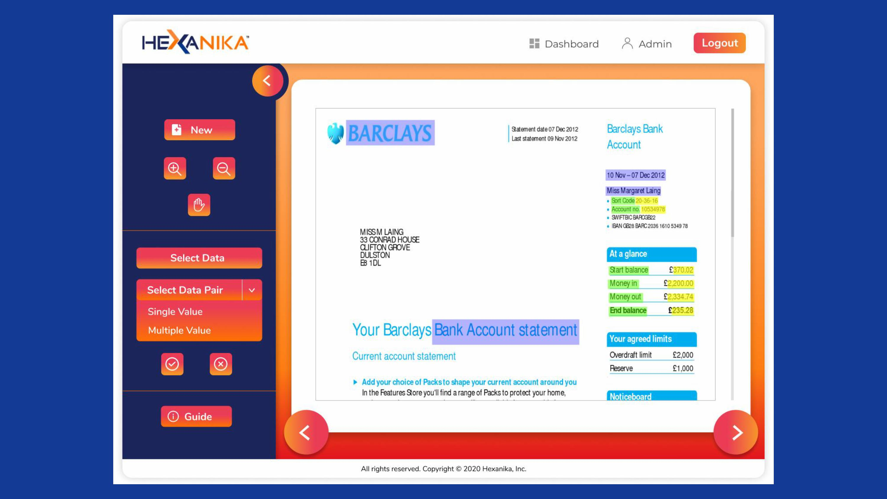
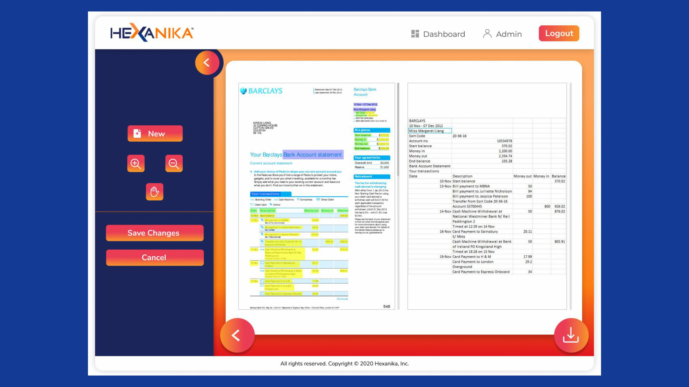
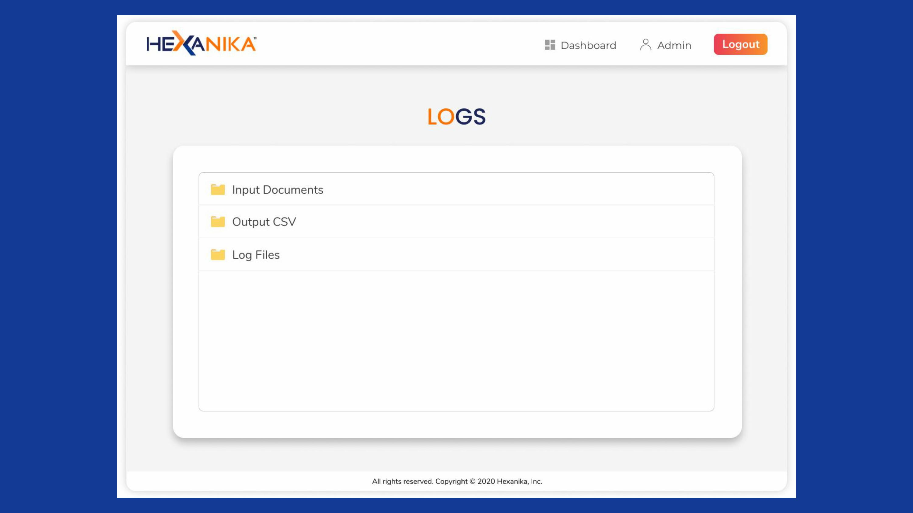
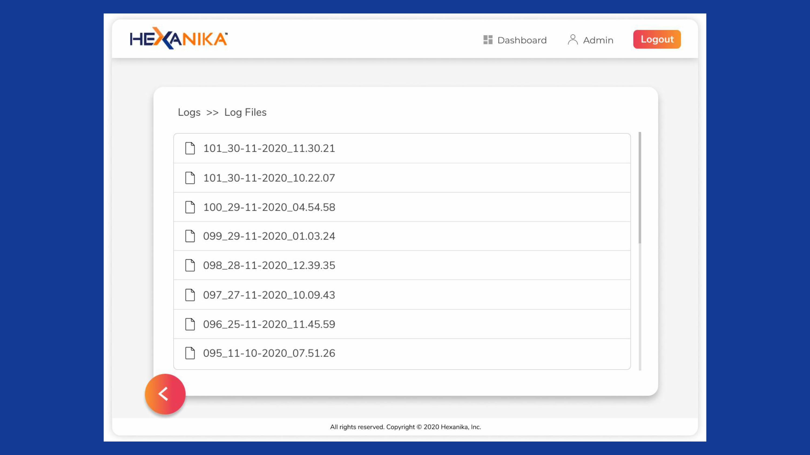
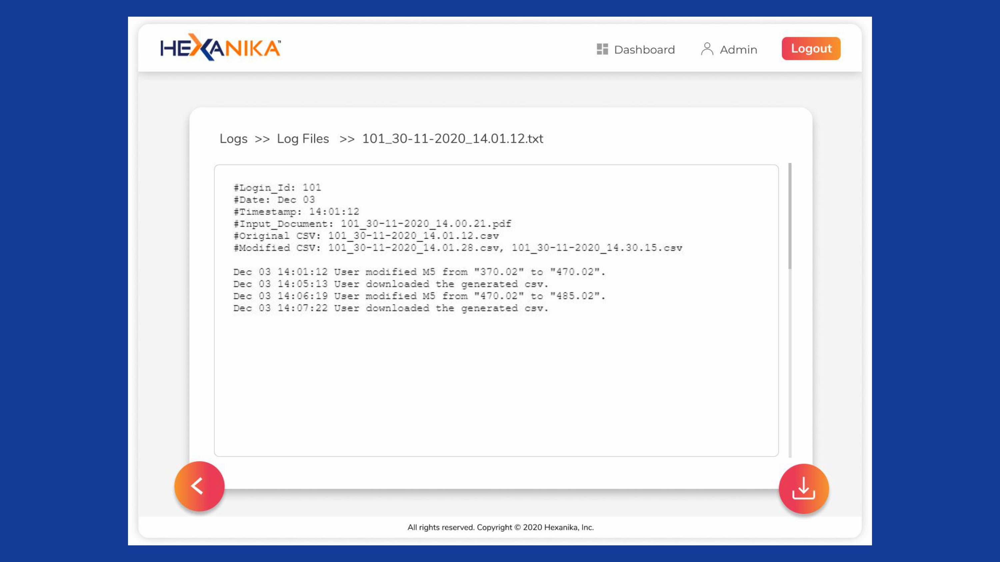

# document-data-extractor
A desktop application for extracting structured data from digitized documents using Optical Character Recognition (OCR), image preprocessing, text parsing, and automated data extraction, with support for data validation and export to structured formats.

  
  
  
  
  
  
  
  
  

